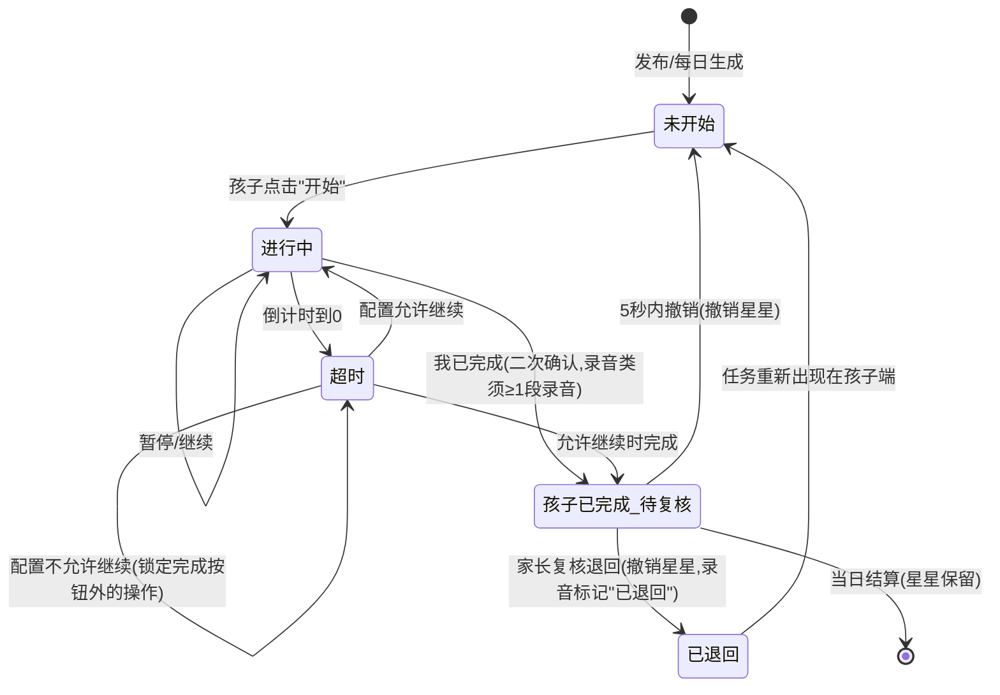
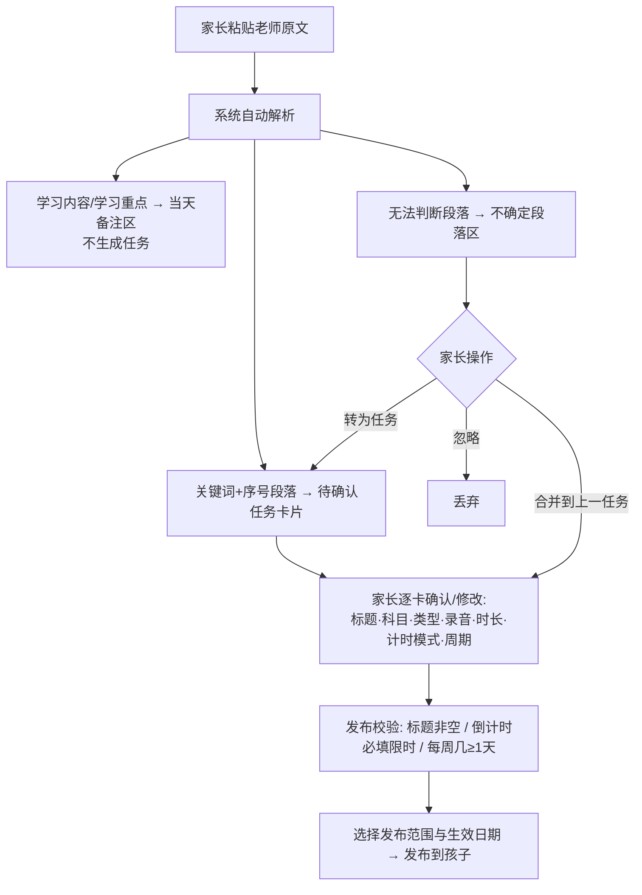

# 儿童作业与习惯工作台 — PRD / 原型说明 / 开发拆解

> 版本：MVP v1.0 ｜ 状态：冻结规则已确认，可直接用于原型与开发
> 本文档严格遵守第二节"冻结规则"，不做任何改动；存在的疑点统一列入第 12 章"风险与待确认问题"。

---

## 目录

1. [PRD 摘要](#1-prd-摘要)
2. [角色权限矩阵](#2-角色权限矩阵)
3. [孩子端页面清单与文字线框](#3-孩子端页面清单与文字线框)
4. [家长后台页面清单与文字线框](#4-家长后台页面清单与文字线框)
5. [任务状态流转图](#5-任务状态流转图)
6. [数据模型表](#6-数据模型表)
7. [文本导入二次处理流程与解析规则](#7-文本导入二次处理流程与解析规则)
8. [周期任务与习惯任务生成规则](#8-周期任务与习惯任务生成规则)
9. [激励与复核规则](#9-激励与复核规则)
10. [MVP 验收标准](#10-mvp-验收标准)
11. [开发任务拆分](#11-开发任务拆分)
12. [风险与待确认问题](#12-风险与待确认问题)

---

## 1. PRD 摘要

| 项目 | 内容 |
|---|---|
| 产品名称 | 儿童作业与习惯工作台（MVP） |
| 目标用户 | 小学 1-7 年级孩子（1 名）及其家长（多家长绑定） |
| 核心目标 | 家长稳定产出每日任务 → 孩子端闭环执行（计时/录音/勾选）→ 星星、连续天数、徽章即时反馈 → 家长可复核退回 |
| 孩子端设备 | Android 平板 |
| 家长后台 | Web（第一版） |
| 孩子数量 | 第一版仅 1 个孩子，多家长绑定 |
| 核心闭环 | 发布任务 → 孩子执行（计时/录音）→ 勾选完成即得星 → 家长复核（仅退回）→ 退回后重做 |
| MVP 边界（不做） | 自动语音评分、复杂单双周课表、老师端、多孩子、游戏化商城、图片作业自动识别 |

---

## 2. 角色权限矩阵

| 能力 \ 角色 | 爸爸/妈妈（管理员） | 爷爷/奶奶（只读） | 孩子（平板端） |
|---|:---:|:---:|:---:|
| 登录与绑定孩子 | ✅ | ✅（被邀请） | 免登录或固定设备 |
| 编辑/发布任务 | ✅ | ❌ | ❌ |
| 文本导入与二次确认 | ✅ | ❌ | ❌ |
| 周期任务/习惯任务管理 | ✅ | ❌ | ❌ |
| 课表管理、临时调课 | ✅ | ❌ | ❌ |
| 查看任务与完成情况 | ✅ | ✅ | ✅（本人今日） |
| 听录音回放 | ✅ | ✅ | ✅（本人录音） |
| 复核退回 | ✅ | ❌ | ❌ |
| 激励设置（星星/徽章规则） | ✅ | ❌ | ❌ |
| 注音开关（一年级模式） | ✅ | ❌ | ❌ |
| 执行任务：计时/录音/勾选 | ❌ | ❌ | ✅ |
| 查看奖励与徽章 | ✅ | ✅ | ✅ |

---

## 3. 孩子端页面清单与文字线框

### 3.1 页面清单

| 编号 | 页面 | 说明 |
|---|---|---|
| K1 | 今日工作台（首页） | 日期、星星、连续天数、今日备注、进度、任务卡片列表 |
| K2 | 普通作业执行页 | 计时（正/倒）、暂停、超时处理、完成勾选 |
| K3 | 朗读/口述/背诵执行页 | 正计时 + 录音/回放/重录 + 完成勾选 |
| K4 | 习惯任务执行页 | 提醒时间、明日课表、检查清单、（可选）拍照 |
| K5 | 奖励页 | 星星总数、星星明细（简化）、奖励兑换展示 |
| K6 | 徽章页 | 已获得/未获得徽章、连续完成天数 |

### 3.2 K1 今日工作台（文字线框）

```
┌──────────────────────────────────────────────┐
│ 2026年11月11日 星期三     ⭐ 128   🔥连续 6 天 │
├──────────────────────────────────────────────┤
│ 📌 今日备注（可折叠）                          │
│  学习内容：10的加减法(P56)（一年级模式全文注音）  │
├──────────────────────────────────────────────┤
│ 今日进度 ▓▓▓▓▓▓░░░░ 3/5                        │
├──────────────────────────────────────────────┤
│ ⏰ [置顶·习惯] 整理明天书包        提醒 20:00    │
│    明日课表：语文/数学/美术（美术带彩笔）        │
│    状态：未开始        [ 去完成 ]               │
├──────────────────────────────────────────────┤
│ 📐 数学 | 说一说一图三式                        │
│    口述·需录音 | 预计10分钟 | 正计时             │
│    状态：未开始        [ 开 始 ]                │
├──────────────────────────────────────────────┤
│ 📖 语文 | 朗读课文第3段                         │
│    朗读·需录音 | 限时15分钟 | 倒计时             │
│    状态：已退回（录音保留） [ 重新完成 ]          │
├──────────────────────────────────────────────┤
│ ✅ 数学 | 口算练习20题      用时 8'32"  +1⭐     │
├──────────────────────────────────────────────┤
│        [ 🎁 查看奖励 ]    [ 🏅 查看徽章 ]       │
└──────────────────────────────────────────────┘
```

卡片字段：科目/图标、标题、预计时长、类型标签、计时模式、状态、主按钮（随状态变化：开始/继续/重新完成/已完成置灰）。

### 3.3 K2 普通作业执行页（文字线框）

```
┌──────────────────────────────────────┐
│ ← 返回    数学 · 口算练习20题          │
├──────────────────────────────────────┤
│ 任务说明：完成口算本 P12 全部题目      │
│                                      │
│         ⏱ 08:32  （正计时）           │
│      [ 暂 停 ]   [ 结束计时 ]         │
│                                      │
│ （倒计时模式：剩余 06:28，到时提醒，    │
│   按配置"允许/不允许"继续）            │
│                                      │
│      ┌────────────────────┐          │
│      │   ✅ 我已完成        │          │
│      └────────────────────┘          │
│   （点击 → 二次确认 → +1⭐，5秒内可撤销）│
└──────────────────────────────────────┘
```

### 3.4 K3 朗读/口述/背诵执行页（文字线框）

```
┌──────────────────────────────────────┐
│ ← 返回    语文 · 背10的分与合          │
├──────────────────────────────────────┤
│ 任务说明：背诵10的分与合和加减法        │
│         ⏱ 03:15（正计时）              │
│                                      │
│   ⏺ 开始录音 / ⏹ 停止                 │
│   录音 2 段 · 共 1'48"                │
│   ① 0'52"  [▶回放] [🗑]              │
│   ② 0'56"  [▶回放] [🔁重录]           │
│   （已退回的录音标记"已退回"，可重录）    │
│                                      │
│   ┌────────────────────┐             │
│   │ ✅ 我已完成（无录音时置灰）│         │
│   └────────────────────┘             │
└──────────────────────────────────────┘
```

### 3.5 K4 习惯任务执行页（文字线框）

```
┌──────────────────────────────────────┐
│ ← 返回    🎒 整理明天的书包   提醒20:00 │
├──────────────────────────────────────┤
│ 明日课表：语文 / 数学 / 美术           │
│ 备注：美术带彩笔                       │
│ 检查清单：                             │
│  □ 按课表放好课本                      │
│  □ 文具盒装好                          │
│  □ 水杯装好                            │
│ （如配置需拍照：[📷 拍照上传]）         │
│      ┌────────────────────┐          │
│      │   ✅ 我已完成        │          │
│      └────────────────────┘          │
└──────────────────────────────────────┘
```

---

## 4. 家长后台页面清单与文字线框

### 4.1 页面清单

| 编号 | 页面 | 核心功能 |
|---|---|---|
| P0 | 登录与孩子绑定 | 家长注册/登录、绑定孩子、邀请其他家长 |
| P1 | 家长权限管理 | 设置角色（管理员/只读） |
| P2 | 今日任务发布 | 手动新建单条任务并发布 |
| P3 | 文本导入（二次处理确认页） | 粘贴老师文本 → 自动解析 → 确认发布 |
| P4 | 周期任务管理 | 周期规则列表、启停、生效/结束日期 |
| P5 | 习惯任务管理 | 习惯模板 CRUD、提醒时间、每周几、拍照开关 |
| P6 | 课表管理 | 按周固定课表、临时调当天课表 |
| P7 | 完成情况与复核 | 完成列表、听录音、退回、撤销误操作查看 |
| P8 | 激励设置 | 星星规则、徽章规则 |
| P9 | 模式设置 | 一年级模式与全文注音开关 |

### 4.2 P3 文本导入二次处理确认页（文字线框，左侧原文 / 右侧处理结果）

```
┌───────────────────────┬────────────────────────────────────┐
│ 原文（只读）            │ A. 当天备注区                        │
│ 学习内容：10的加减法     │  [学习内容+学习重点自动填入，多行可编辑]│
│ 学习重点：…             │  ☑显示给孩子   ☑一年级注音           │
│ 今日巩固：              ├────────────────────────────────────┤
│ 1.【说一说】…           │ B. 待确认任务卡片                     │
│ 2.如上 🐰…             │ ┌──────────────────────────────────┐ │
│ 3.【背一背】…           │ │标题[说一说一图三式        ]        │ │
│                        │ │科目[数学▾] 类型[口述▾] ☑需录音    │ │
│                        │ │预计[10]分钟 计时[正计时▾]          │ │
│                        │ │限时[__]分钟（倒计时必填）           │ │
│                        │ │超时提醒[5]分钟 ☑超时后允许继续      │ │
│                        │ │周期[仅今天▾] 每周几[___________]  │ │
│                        │ │说明[…]              [删除]         │ │
│                        │ └──────────────────────────────────┘ │
│                        │ ┌──────────────────────────────────┐ │
│                        │ │⚠标题[如上（请修改）]（需确认）      │ │
│                        │ │ …                                │ │
│                        │ └──────────────────────────────────┘ │
│                        ├────────────────────────────────────┤
│                        │ C. 不确定段落区（原文片段只读）         │
│                        │ 「2.如上 🐰🐰…」                     │ │
│                        │ [转为任务][合并到上一任务][忽略]       │ │
│                        ├────────────────────────────────────┤
│                        │ D. 发布区                            │
│                        │ 范围[仅今天▾] 生效[11-11] 结束[__]   │ │
│                        │ 校验：标题非空/倒计时必填限时/每周几    │ │
│                        │ ≥选1天        [ ✅ 发布到孩子 ]       │ │
└───────────────────────┴────────────────────────────────────┘
```

---

## 5. 任务状态流转图



状态枚举（与页面一致）：`未开始 / 进行中 / 孩子已完成（待复核） / 已退回 / 超时`。

关键规则：
- 孩子勾选即完成、完成即得星；复核只有"退回"，无"通过"动作。
- 退回后撤销该任务星星，录音保留并标记"已退回"，孩子重录后可再次完成。
- 录音类任务：无录音时"我已完成"置灰（冻结规则 9）。

---

## 6. 数据模型表

### 6.1 TaskInstance（任务实例）

| 字段 | 类型 | 说明 |
|---|---|---|
| id | string (uuid) | 主键 |
| child_id | string | 所属孩子（v1 固定 1 个） |
| date | date | 任务所属日期 |
| title | string | 任务标题（非空，发布校验） |
| subject | enum | 语文/数学/英语/其他 |
| category | enum | 学业 / 朗读口述背诵 / 习惯 |
| type | enum | 说一说/背一背/读一读/写一写/算一算/练一练/习惯/其他 |
| source | enum | 手动 / 文本导入 / 周期生成 / 习惯模板 |
| note | text | 任务说明 |
| estimated_minutes | int? | 预计时长 |
| timer_mode | enum | stopwatch（正计时）/ countdown（倒计时） |
| limit_minutes | int? | 限时时长（倒计时必填） |
| overtime_remind | int? | 超时提醒（分钟，可配置） |
| allow_continue | bool | 超时后是否允许继续 |
| need_recording | bool | 是否需要录音（录音类默认 true） |
| period_rule_id | string? | 来源周期规则 |
| status | enum | 未开始/进行中/孩子已完成/待复核/已退回/超时 |
| actual_seconds | int? | 实际用时 |
| completed_at | datetime? | 完成时间 |
| reviewed_by | string? | 复核家长 |
| reviewed_at | datetime? | 复核时间 |
| star_awarded | int | 已发星星数（退回时撤销） |
| parent_note | text? | 家长备注/退回原因 |
| created_by | string | 创建家长 |

### 6.2 PeriodRule（周期规则）

| 字段 | 类型 | 说明 |
|---|---|---|
| id | string | 主键 |
| freq | enum | once（仅今天）/ daily（每天）/ weekly（每周几） |
| weekdays | int[]? | 每周几时必填，至少 1 天（1-7） |
| start_date | date | 生效日期 |
| end_date | date? | 结束日期 |
| active | bool | 启停 |

### 6.3 HabitTemplate（习惯任务模板）

| 字段 | 类型 | 说明 |
|---|---|---|
| id | string | 主键 |
| name | string | 如"整理明天书包" |
| icon | string | 图标 |
| remind_time | time | 提醒时间（到时孩子端置顶） |
| weekdays | int[] | 每周哪几天生效 |
| need_photo | bool | 是否需拍照 |
| need_review | bool | 是否需复核 |
| star_enabled | bool | 完成是否得星 |
| linked_timetable | bool | 是否显示明日课表 |
| checklist | text[] | 检查清单 |
| active | bool | 启停 |

### 6.4 Timetable（课表）

| 字段 | 类型 | 说明 |
|---|---|---|
| id | string | 主键 |
| weekday | int (1-7) | 周几（按周固定） |
| subjects | text[] | 当天科目列表 |
| notes | text? | 备注（如"美术带彩笔"） |
| date_override | date? | 临时调课：指定日期覆盖固定课表 |

### 6.5 Recording（录音）

| 字段 | 类型 | 说明 |
|---|---|---|
| id | string | 主键 |
| task_instance_id | string | 关联任务实例 |
| file_url | string | 文件地址 |
| duration | int | 时长（秒） |
| rejected_flag | bool | 是否"已退回"标记 |
| created_at | datetime | 创建时间 |

### 6.6 DailyNote（当天备注）

| 字段 | 类型 | 说明 |
|---|---|---|
| id | string | 主键 |
| date | date | 日期 |
| note | text | 学习内容/学习重点（仅备注，不生成任务） |
| show_to_child | bool | 是否显示给孩子 |
| pinyin_enabled | bool | 一年级注音开关（仅一年级模式生效） |
| created_by | string | 创建家长 |

### 6.7 ParentChildRelation（家长关系）

| 字段 | 类型 | 说明 |
|---|---|---|
| id | string | 主键 |
| parent_id | string | 家长账号 |
| child_id | string | 孩子 |
| role | enum | admin（爸爸/妈妈）/ readonly（爷爷奶奶） |

### 6.8 PointLog（积分记录）

| 字段 | 类型 | 说明 |
|---|---|---|
| id | string | 主键 |
| child_id | string | 孩子 |
| task_id | string | 关联任务 |
| delta | int | +1 得星 / -1 退回撤销 |
| reason | enum | complete / revoke_reject / undo |
| created_at | datetime | 时间 |

---

## 7. 文本导入二次处理流程与解析规则

### 7.1 流程图



### 7.2 解析规则（C 方案）

| 规则 | 说明 |
|---|---|
| 备注识别 | "学习内容：""学习重点："段落 → 当天备注，可编辑，不生成任务，不挂到任务参考下 |
| 任务关键词 | 【说一说】【背一背】【读一读】【写一写】【算一算】【练一练】 + 数字序号 → 各生成一张待确认任务卡 |
| 科知识别 | 语文/数学/英语等科目关键词自动填入"科目" |
| 页码/时长 | "(P56)"等页码写入说明；"X分钟"填入预计时长 |
| 录音默认 | 说一说/背一背/读一读（口述背诵朗读类）默认勾选"需要录音" |
| 周期默认 | 一律"仅今天"，家长在确认页改为"每天/每周几"；周期不靠文本解析 |
| 不确定段落 | 进入"不确定段落区"，操作：转为任务 / 合并到上一任务 / 忽略 |
| 弱信息任务 | 如"2.如上"：仍生成卡片，标题默认"如上（请修改）"并标记需确认 |

### 7.3 样例映射（以需求中样例文本为准）

| 原文段落 | 解析结果 |
|---|---|
| 学习内容：10的加减法(P56) | 当天备注 |
| 学习重点 1、2 | 当天备注 |
| 1.【说一说】…一图三式… | 任务：说一说一图三式；数学；口述；需录音；时长待填；仅今天 |
| 2.如上 🐰… | 不确定段落 → 生成需确认卡"如上（请修改）"（或由家长合并/忽略），家长改为"看图说一图三式（第2题）" |
| 3.【背一背】背10的分与合和加减法 | 任务：背10的分与合和加减法；背诵；需录音；仅今天 |

---

## 8. 周期任务与习惯任务生成规则

### 8.1 周期任务

| 项 | 规则 |
|---|---|
| 配置入口 | 导入确认页"发布范围"或 P4 周期任务管理 |
| 频率 | 仅今天 / 每天 / 每周几（weekly 至少选 1 天） |
| 生成方式 | 系统按 PeriodRule 在当日 00:00（或首次打开时惰性）为当天生成 TaskInstance，source=周期生成 |
| 生效窗口 | start_date ~ end_date；active=false 停止生成，已生成实例不受影响 |
| 修改策略 | 修改周期规则只影响未来日期，不回改历史实例 |
| 课表 | 按周固定；临时调课由家长在 P6 手动改当天（date_override），不走解析 |

### 8.2 习惯任务

| 项 | 规则 |
|---|---|
| 建法 | 单独在 P5 建立，不走文本导入 |
| 生成 | 按 weekdays 每日生成 category=习惯 的 TaskInstance |
| 提醒 | 到达 remind_time，孩子端卡片置顶 |
| 明日课表 | linked_timetable=true 时，卡片显示"明日课表"及备注（如"美术带彩笔"） |
| 拍照 | need_photo=true 时执行页显示拍照上传 |
| 得星 | star_enabled 控制完成是否得星 |

---

## 9. 激励与复核规则

| 规则 | 说明 |
|---|---|
| 得星 | 孩子勾选"我已完成"（二次确认后）立即 +1⭐，状态进入"孩子已完成/待复核" |
| 撤销窗口 | 完成后 5 秒内可撤销，同时撤销星星（PointLog: undo） |
| 连续天数 | 当天全部任务完成 → 连续天数 +1；中断清零 |
| 徽章 | 按累计星星/连续天数触发（规则在 P8 配置） |
| 复核 | 家长复核**只有"退回"**，无"通过才完成"；退回需可填原因（parent_note） |
| 退回效果 | 撤销该任务星星（PointLog: revoke_reject）→ 任务回到孩子端重新出现 → 录音保留并标记"已退回" → 孩子重录后可再次完成得星 |
| 权限 | 仅管理员（爸爸/妈妈）可复核；只读家长（爷爷/奶奶）仅可查看与听录音 |

---

## 10. MVP 验收标准

| # | 验收项 | 通过标准 |
|---|---|---|
| 1 | 文本导入解析 | 粘贴样例文本后，学习内容/学习重点进入备注；【说一说】【背一背】各生成 1 张待确认卡；"2.如上"进入需确认/不确定区 |
| 2 | 导入发布校验 | 标题为空、倒计时未填限时、每周几未选天均无法发布，并给出明确提示 |
| 3 | 今日工作台展示 | 孩子端正确显示日期、星星数、连续天数、今日备注、进度条、三类任务卡片及状态 |
| 4 | 一年级注音 | 注音开关打开且为一年级模式时，今日备注与任务标题全文注音；2-7 年级模式不注音 |
| 5 | 正计时 | 普通作业默认正计时，可暂停/继续/结束，实际用时正确入库 |
| 6 | 倒计时与超时 | 设置限时后进入倒计时；到时按配置触发超时提醒；按配置允许/禁止继续 |
| 7 | 录音闭环 | 朗读类任务可录音/回放/重录；无录音时"我已完成"置灰；至少一段录音才可完成 |
| 8 | 完成即得星 | 勾选完成（二次确认）后立即 +1⭐；5 秒内撤销则星星同步撤销 |
| 9 | 复核退回 | 管理员退回后：星星撤销、录音保留且标记"已退回"、任务重新出现在孩子端、重录后可再次完成 |
| 10 | 只读权限 | 爷爷奶奶账号不能编辑/发布/复核，仅可查看与听录音；越权操作被拦截 |
| 11 | 周期任务 | "每天/每周几"规则在生效窗口内每日自动生成实例；停用后不再生成 |
| 12 | 习惯任务 | 到提醒时间卡片置顶；整理书包卡片正确显示明日课表与备注（含临时调课后的课表） |
| 13 | 临时调课 | 家长在课表管理修改某天课表后，次日习惯卡片显示修改后的课表 |
| 14 | 多端同步 | 孩子端完成/家长端退回后，另一端刷新（或实时）状态一致 |

---

## 11. 开发任务拆分

### 11.1 前端 — 孩子端（Android 平板，Web/PWA 或原生壳）

| 模块 | 任务 |
|---|---|
| K1 今日工作台 | 顶部栏（日期/星星/连续天数）、备注折叠卡、进度条、任务卡片列表（按状态渲染按钮）、到点置顶、明日课表卡 |
| K2 普通作业执行 | 正/倒计时组件、暂停/继续、超时提醒与锁定逻辑、完成二次确认、5 秒撤销 |
| K3 录音任务执行 | 录音（MediaRecorder）/回放/重录/段数时长展示、无录音置灰 |
| K4 习惯任务执行 | 提醒时间、明日课表、检查清单、拍照上传（可选） |
| K5/K6 奖励与徽章 | 星星明细、徽章墙 |
| 公共 | 注音渲染组件（一年级模式）、状态机驱动 UI、离线弱网提示 |

### 11.2 前端 — 家长后台（Web）

| 模块 | 任务 |
|---|---|
| P0/P1 账号权限 | 登录、绑定孩子、邀请家长、角色管理（admin/readonly）与路由守卫 |
| P2 今日发布 | 手动新建任务表单（含全部字段与校验） |
| P3 文本导入 | 左右分栏、解析结果渲染、任务卡编辑、不确定段落三操作、发布校验 |
| P4 周期管理 | 规则列表、新建/编辑/启停 |
| P5 习惯管理 | 模板 CRUD、提醒时间、每周几、拍照/得星/课表联动开关 |
| P6 课表管理 | 周课表编辑、临时调课（date_override） |
| P7 复核 | 完成列表、录音播放器、退回（填原因） |
| P8/P9 激励与模式 | 星星/徽章规则配置、一年级模式与注音开关 |

### 11.3 后端

| 模块 | 任务 |
|---|---|
| 账号与权限 | 家长账号、孩子绑定、RBAC（admin/readonly）、孩子端设备凭证 |
| 任务服务 | TaskInstance CRUD、状态机（含超时、撤销窗口、退回）、发布校验 |
| 导入解析服务 | 关键词/序号/科目/页码/时长解析，输出备注+任务卡+不确定段落 |
| 周期引擎 | 每日生成器（cron/惰性生成）、规则启停与生效窗口 |
| 习惯引擎 | 模板→每日实例、提醒触发、明日课表查询（含 override） |
| 录音服务 | 上传/存储/播放地址、段管理、退回标记 |
| 激励服务 | PointLog、星星汇总、连续天数、徽章触发 |
| 课表服务 | 周课表 + date_override 查询 |

### 11.4 数据

| 任务 | 说明 |
|---|---|
| 建表 | 8 张表（见第 6 章）+ 用户/孩子表 |
| 索引 | TaskInstance(child_id, date)、PointLog(child_id)、Recording(task_instance_id) |
| 迁移与种子 | 默认习惯模板示例、默认激励规则 |

### 11.5 测试

| 类型 | 覆盖 |
|---|---|
| 单元测试 | 导入解析器（样例文本必测）、状态机、周期生成、星星撤销 |
| 接口测试 | 权限拦截（readonly 越权）、发布校验 |
| E2E | 验收标准 1-14 全链路（发布→执行→完成→退回→重做） |
| 设备测试 | 目标 Android 平板录音/计时/兼容性 |

---

## 12. 风险与待确认问题

| # | 问题 | 说明 |
|---|---|---|
| 1 | 孩子端技术形态未冻结 | Android 平板可用 PWA/WebView 壳或原生；录音与后台计时在纯 Web 下受限，需确认形态 |
| 2 | 星星数值规则 | 是否所有任务统一 +1⭐？高难任务是否加权？徽章触发阈值表未提供 |
| 3 | 录音存储容量与保留期 | 录音文件保存多久、是否定期清理未定义 |
| 4 | 跨天未完成任务处理 | 当天未开始的任务次日是自动作废、顺延还是保留，规则未定义 |
| 5 | "待复核"与家长"通过"的边界 | 冻结规则规定复核只有退回，但状态枚举含"待复核"；建议确认"待复核"仅为展示态、无通过动作 |

> 无冻结规则冲突；以上 5 项均不影响按本文档启动原型与开发。

---

*文档结束。冻结规则（背景第二节 1-19 条）逐条已落实，未做修改。*
